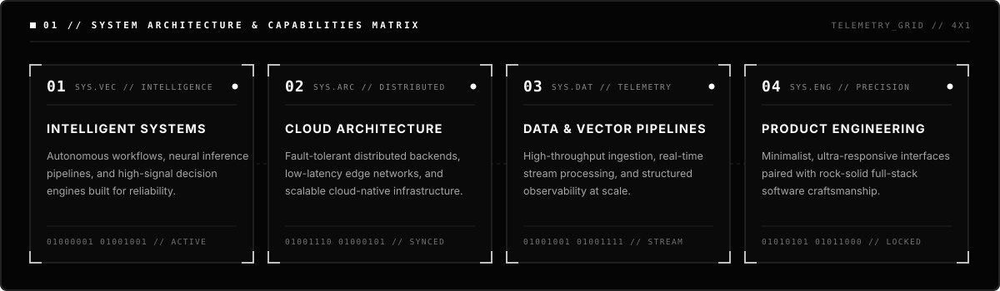
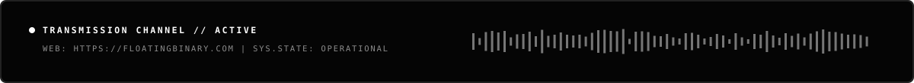

 

 

| `01 // ORIGIN` | `02 // ETHOS` | `03 // DIRECT UPLINK` |
| :--- | :--- | :--- |
| **Floating Binary Software Systems Inc.** is a dynamic software development company offering innovative solutions that empower businesses to thrive in today's ever-evolving landscape. | We strip away noise and complexity to engineer resilient, high-contrast software systems—where mathematical precision meets modern distributed architecture. | **Web:** [floatingbinary.com](https://floatingbinary.com) **GitHub:** [@floatingbinary](https://github.com/floatingbinary) **Status:** `SYS_ONLINE // 99.98%` |

 

